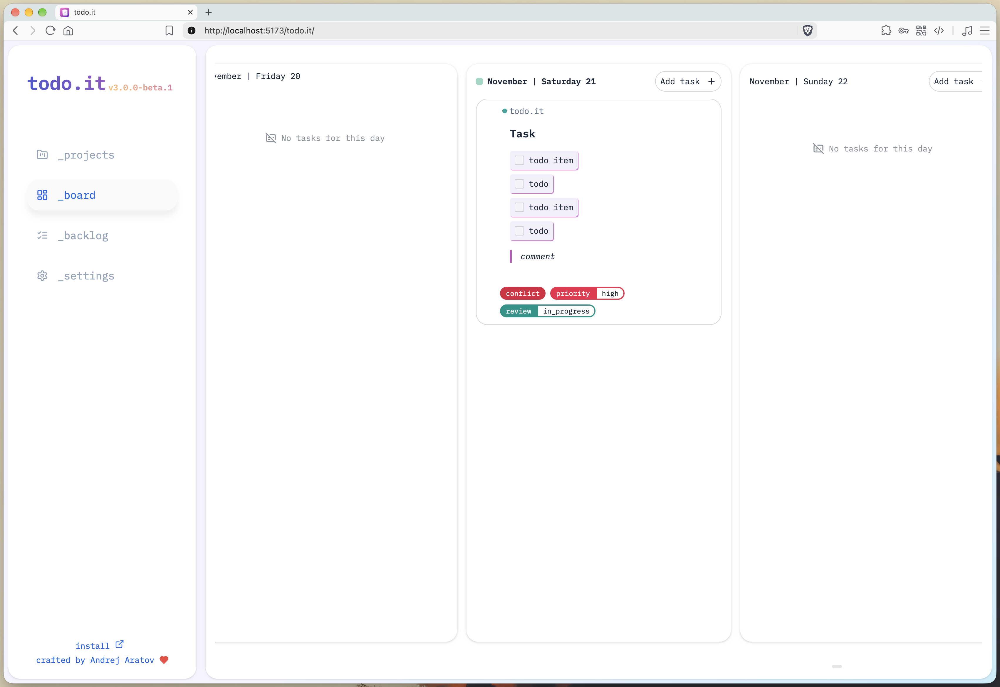
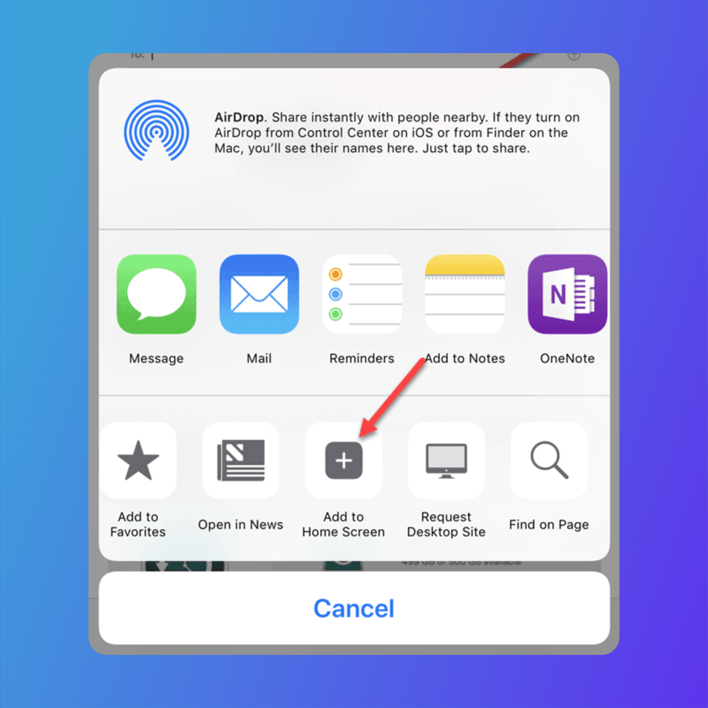
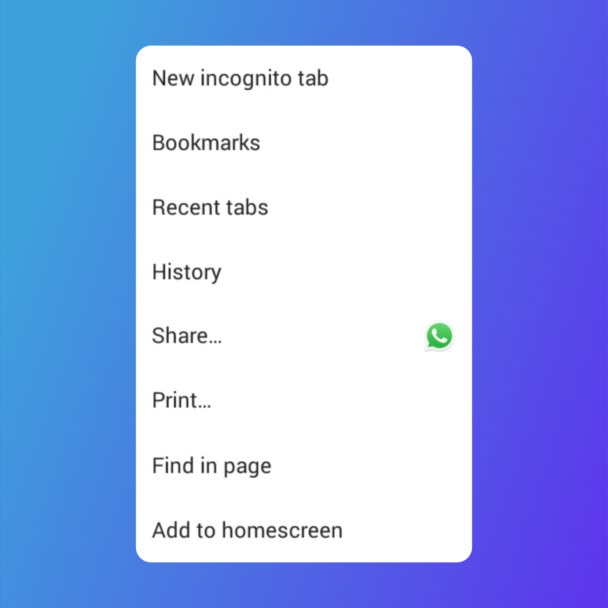

# todo.it – another todo app but with features

App for operational planning and decomposition of tasks


> **Beta:** `3.0.0-beta.1` is a desktop-first release. Mobile layout is temporarily unavailable — the app shows a stub below 1024px width.

## Idea

The idea of the application is to transform a text file that I used for planning...

```txt
Monday (date)
- task
- task
- task

Tuesday (date)
- task
- task
- task

Wednesday (date)
- task
- task
- task

Thursday (date)
- task
...
...
...

Backlog
- task
- task
- task
  description
...
```

To the interface, for automatization of calendar generating, history of tasks and backlog for future tasks:



## Features

- Automatic calendar generating
- Last 6 months tasks history
- Markdown support (include todo items `- [x] task`)
- Backlog for future tasks
- Create, edit, copy, delete tasks
- Projects for grouping tasks (with done/overall counters)
- Move tasks between days and backlog, assign tasks to projects
- Scopes labels for tasks
- Drag'n'drop tasks
- PWA available
- Import/Export data to JSON file
- Rows/Columns view
- Dark theme support
- Works offline
- Desktop-first layout (mobile version is coming soon)

## How data is stored?

There is no backend. Tasks, projects, scopes and labels are stored in the IndexedDB database `todo.it` of your browser; UI settings (view type, last calendar update) stay in `localStorage`. Data saved by versions before 3.0 in `localStorage` is migrated to IndexedDB automatically on the first launch, and the old keys are removed after a successful migration. Export a JSON copy from Settings → Backup regularly: browser storage can be cleared by the browser itself.

## Install application on your device

> Mobile layout is not available in `3.0.0-beta.1`, so the instructions below apply to a future release. On screens narrower than 1024px the app shows a "Mobile version is coming soon" stub.

### iOS

Open the following link on your iPhone or iPad: [https://begprod.github.io/todo.it/](https://begprod.github.io/todo.it/)

Push the button "Share" in the browser menu, then push the button "Add to Home Screen":



### Android

Open the following link on your Android device: [https://begprod.github.io/todo.it/](https://begprod.github.io/todo.it/)

Push the button "Add to Home screen" in the browser menu:



## For developers

### Recommended IDE Setup

[VSCode](https://code.visualstudio.com/) + [Vue - Official](https://marketplace.visualstudio.com/items?itemName=Vue.volar)

### Project Setup

```sh
npm install
```

#### Compile and Hot-Reload for Development

```sh
npm run dev
```

#### Take a look other commands in `package.json`
